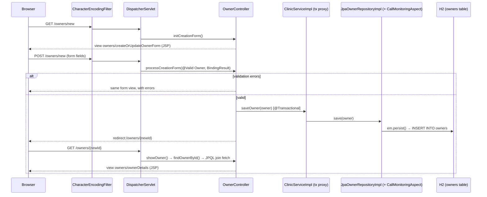
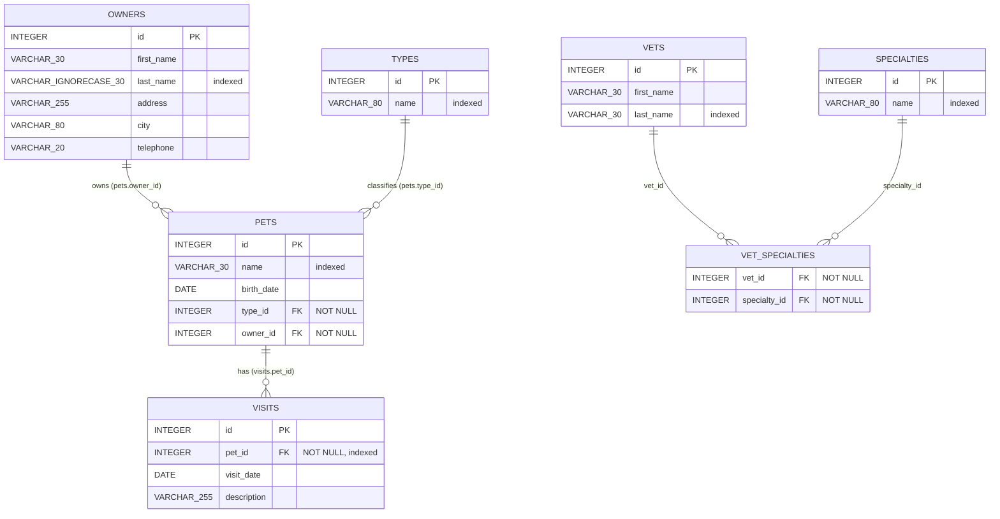

# Spring Framework PetClinic: architecture

This first described the code as of commit `d980667` (10 November 2026). It has since been updated
for the in-place upgrade (11 November 2026), merged into `main` through pull request #1; see
[Changes since the first version](#changes-since-the-first-version). Every statement points to the
file it comes from. Where I checked something by running the app or the build, I say so. Where
something is unclear, I say that too, rather than guess.

This repository is a fork of
[spring-petclinic/spring-framework-petclinic](https://github.com/spring-petclinic/spring-framework-petclinic),
which is itself derived from [spring-projects/spring-petclinic](https://github.com/spring-projects/spring-petclinic)
(see `readme.md`). It is licensed under the Apache License 2.0 (`LICENSE.txt`).

## Changes since the first version

Option B of the owners modernisation plan (upgrade in place) was carried out step by step, with the
full suite run after each step. No business behaviour changed; one configuration difference that
would have changed behaviour was caught and kept as before (see step 4).

| Step | Change | Protected by |
|---|---|---|
| 0 | Smoke tests: `./mvnw verify` now starts the packaged WAR in Jetty on port 9967 (`pom.xml`, jetty and failsafe plugins) and `src/test/java/.../smoke/PetclinicSmokeIT.java` loads every main page with its CSS/JS/images and posts the forms | itself (14 tests) |
| 2 | Build cleanup: JUnit/Mockito now test-scoped (no longer in the WAR); MySQL driver moved to `com.mysql:mysql-connector-j`; retired `maven-eclipse-plugin` removed; Hibernate dialect no longer set explicitly (auto-detected, warning gone); Mockito agent loaded explicitly via surefire `argLine` | full suite |
| 3 | Jetty 11.0.26 → **12.1.14** (`org.eclipse.jetty.ee11:jetty-ee11-maven-plugin`, Servlet 6.1 / Pages 4.0); `WEB-INF/jetty-web.xml` now configures `org.eclipse.jetty.ee11.webapp.WebAppContext` | smoke tests (real JSP rendering) |
| 4 | Spring MVC XML (`mvc-core-config.xml`, `mvc-view-config.xml`) replaced by Java config `config/WebMvcConfig.java`; deprecation warning gone | 108 characterization tests, a 56-request HTTP before/after comparison, and new `ContentNegotiationCharacterizationTests` |

Not done yet: Java 25 (step 1), the Docker image (still `jetty:11.0-jdk17`, not verifiable without
Docker), and the remaining XML (root context) which was optional.

Contents:

1. [What the app does](#1-what-the-app-does)
2. [Tech stack and exact versions](#2-tech-stack-and-exact-versions)
3. [Package structure](#3-package-structure)
4. [How a request flows: adding a new owner](#4-how-a-request-flows-adding-a-new-owner)
5. [Data model](#5-data-model)
6. [How configuration works](#6-how-configuration-works)
7. [Modernisation risks](#7-modernisation-risks)
8. [Open questions](#8-open-questions)

---

## 1. What the app does

PetClinic is a demo web app for a veterinary clinic. Users can:

| Feature | URL | Handler |
|---|---|---|
| Welcome page | `GET /` | view controller, `config/WebMvcConfig.java` (`addViewControllers`) |
| Find owners by last name (prefix match) | `GET /owners/find`, `GET /owners?lastName=` | `web/OwnerController.java:70`, `:76` |
| Add, view and edit an owner | `GET/POST /owners/new`, `GET /owners/{id}`, `GET/POST /owners/{id}/edit` | `web/OwnerController.java:53-125` |
| Add and edit a pet | `GET/POST /owners/{id}/pets/new`, `GET/POST /owners/{id}/pets/{petId}/edit` | `web/PetController.java` |
| Add a visit for a pet | `GET/POST /owners/{id}/pets/{petId}/visits/new` | `web/VisitController.java:69`, `:75` |
| List a pet's visits | `GET /owners/*/pets/{petId}/visits` | `web/VisitController.java:85`. **Broken**, see [7.4](#74-bugs-found-while-mapping) |
| List vets (HTML, JSON, XML) | `GET /vets`, `/vets.json`, `/vets.xml` | `web/VetController.java` |
| Demo error page | `GET /oups` | `web/CrashController.java` |

Java paths in this document are relative to `src/main/java/org/springframework/samples/petclinic/`
unless they start with `src/` or are a root file such as `pom.xml`.

The app's stated purpose is to show "a plain old **Spring Framework configuration**" with "a
**3-layer architecture** (i.e. presentation --> service --> repository)" (`readme.md`). It ships
**three interchangeable persistence implementations**: JDBC, JPA and Spring Data JPA. A Spring
profile picks one at startup; the default is `jpa` (`PetclinicInitializer.java:52`). See
[section 6.3](#63-spring-profiles).

## 2. Tech stack and exact versions

All versions come from `pom.xml` (properties at lines 15-91). The resolved versions were checked
with `./mvnw dependency:list` on 10 November 2026.

**Runtime and build**

| Component | Version | Source |
|---|---|---|
| Java (minimum, compile target) | 17 | `pom.xml:17`. CI tests on 17 and 21 (`.github/workflows/maven-build-main.yml:16`) |
| Maven (minimum) | 3.8.4 | enforcer rule, `pom.xml:504-506` |
| Maven (wrapper) | 3.9.16 | `.mvn/wrapper/maven-wrapper.properties` |
| Packaging | WAR (`petclinic.war`), no `web.xml` | `pom.xml:10`, `failOnMissingWebXml=false` at `pom.xml:386` |
| Dev server and smoke tests | Jetty 12.1.14 (ee11) via `jetty-ee11-maven-plugin` | `pom.xml` (`jetty-maven-plugin.version`). The startup log confirms `jetty-12.1.14` |
| Docker image base | `jetty:11.0-jdk17`, built with Jib 3.5.2. **Not yet upgraded**: still Jetty 11 | `pom.xml` (jib plugin) |

**Application libraries**

| Area | Library | Version |
|---|---|---|
| Core | Spring Framework (`spring-webmvc`, `-jdbc`, `-orm`, `-oxm`, `-context-support`; others transitive) | 7.0.10 |
| Persistence | Spring Data BOM 2026.0.1, giving `spring-data-jpa` / `spring-data-commons` | 4.1.1 |
| | Hibernate ORM (`hibernate-core`, `hibernate-jcache`) | 7.4.14.Final |
| | Jakarta Persistence API | 3.2.0 |
| | Tomcat JDBC connection pool (`tomcat-jdbc`) | 11.0.18 |
| Validation | Hibernate Validator / Jakarta Validation API | 9.1.4.Final / 3.1.1 |
| Databases (one per Maven profile) | H2 (default) | 2.5.252 |
| | HSQLDB | 2.7.4 |
| | MySQL driver (`com.mysql:mysql-connector-j`) | 8.1.0 |
| | PostgreSQL driver | 42.7.13 |
| Web / view | Jakarta Servlet API (provided) | 6.1.0 |
| | JSP + JSTL (`jakarta.servlet.jsp.jstl-api` / GlassFish impl) | 3.0.2 / 3.0.1 |
| | `tomcat-jasper-el` (provided) | 11.0.18 |
| | Bootstrap (WebJar) | 5.3.8 |
| | Font Awesome (WebJar) | 4.7.0 |
| | flatpickr date picker (WebJar) | 4.6.13 |
| JSON / XML | Jackson 3 (`tools.jackson`) | 3.2.3 |
| | JAXB API / runtime, Jakarta Activation | 4.0.5 / 4.0.9, 2.1.4 |
| Caching | Caffeine | 3.2.4 |
| AOP | AspectJ weaver | 1.9.25.1 |
| Logging | SLF4J / Logback | 2.0.18 / 1.6.6 |

**Tests** (`pom.xml:60-65`): JUnit Jupiter 6.1.3, Mockito 5.24.0, AssertJ 3.27.7,
Hamcrest 3.0, json-path 3.0.0, `spring-test` 7.0.10. JaCoCo 0.8.15 measures coverage
(`pom.xml:83`).

## 3. Package structure

Root package: `org.springframework.samples.petclinic` (`src/main/java/...`).

| Package / file | Purpose |
|---|---|
| `config` | `WebMvcConfig`: Java configuration for Spring MVC (the servlet context). |
| `PetclinicInitializer` | Bootstraps the web app in place of `web.xml`. Creates the root Spring context from XML and the servlet context from `config.WebMvcConfig`, and registers the `DispatcherServlet` and a UTF-8 filter. |
| `model` | JPA entities and domain logic (`Owner`, `Pet`, `Visit`, `Vet`, `Specialty`, `PetType`, base classes). `Vets` is a JAXB wrapper for XML/JSON output. |
| `repository` | Persistence interfaces, one per aggregate (`OwnerRepository`, `PetRepository`, `VetRepository`, `VisitRepository`). |
| `repository.jdbc` | Implementation using `JdbcClient` / `SimpleJdbcInsert` and hand-written SQL, active under profile `jdbc`. |
| `repository.jpa` | Implementation using a JPA `EntityManager` and JPQL, active under profile `jpa` (the default). |
| `repository.springdatajpa` | Spring Data repository interfaces with `@Query`, active under profile `spring-data-jpa`. |
| `service` | `ClinicService` facade and `ClinicServiceImpl`, where transactions (`@Transactional`) and caching (`@Cacheable`) are declared. |
| `web` | Spring MVC controllers plus `PetTypeFormatter` (form string to `PetType`) and `PetValidator`. |
| `util` | `CallMonitoringAspect` (JMX-exposed timing aspect around repositories) and `EntityUtils` (find-by-id in a collection). |

Other source folders:

| Path | Purpose |
|---|---|
| `src/main/resources/spring/` | Spring XML config for the root context (services, persistence, tools) plus `data-access.properties`. The reason is given in `src/main/webapp/WEB-INF/no-spring-config-files-there.txt`. |
| `src/main/resources/db/{h2,hsqldb,mysql,postgresql}/` | `schema.sql` and `data.sql` per database |
| `src/main/resources/messages/` | i18n bundles: default, `en`, `de`, `es` |
| `src/main/webapp/WEB-INF/jsp/` | JSP views |
| `src/main/webapp/WEB-INF/tags/` | JSP tag files: page layout, header, footer, form fields |
| `src/main/webapp/resources/` | Static CSS, images and SCSS sources |
| `src/test/java/...` | Unit, MVC and service integration tests (see [7.3](#73-missing-tests)) |
| `src/test/jmeter/petclinic_test_plan.jmx` | JMeter load-test plan. It isn't run by the build. |

## 4. How a request flows: adding a new owner

I traced this on the running app (default profile `jpa`, H2) on 10 November 2026. A valid
`POST /owners/new` returned `302 Found` with `Location: /owners/11`, and the server logged
`Hibernate: insert into owners (address,city,first_name,last_name,telephone,id) values (?,?,?,?,?,default)`.

Step by step:

1. **Container entry.** All paths go to Spring's `DispatcherServlet` (servlet mapping `/`,
   `PetclinicInitializer.java:70`). A `CharacterEncodingFilter("UTF-8", true)` runs first
   (`PetclinicInitializer.java:77`).
2. **`GET /owners/new` shows the form.** `OwnerController.initCreationForm` puts an empty `Owner`
   in the model and returns view name `owners/createOrUpdateOwnerForm` (`web/OwnerController.java:53-58`).
3. **View resolution.** The JSP view resolver (`registry.jsp("/WEB-INF/jsp/", ".jsp")` in
   `config/WebMvcConfig.java`, `configureViewResolvers`) resolves that name to
   `src/main/webapp/WEB-INF/jsp/owners/createOrUpdateOwnerForm.jsp`. The page uses
   `<form:form modelAttribute="owner">` and the `petclinic:inputField` tag
   (`src/main/webapp/WEB-INF/tags/inputField.tag`), inside the shared `layout.tag`. The form has no
   `action`, so it posts back to `/owners/new`.
4. **`POST /owners/new` binds the data.** `@InitBinder` blocks binding of `id`
   (`web/OwnerController.java:48-51`), so a client can't choose the primary key. Form fields bind
   onto a new `Owner`.
5. **Validation.** `@Valid` runs Bean Validation, which `@EnableWebMvc` enables
   (`config/WebMvcConfig.java`) with Hibernate Validator on the classpath. The rules are
   `@NotEmpty` on `firstName`/`lastName` (`model/Person.java:31,35`), `@NotEmpty` on
   `address`, `city` and `telephone`, and `@Digits(integer = 10, fraction = 0)` on `telephone`
   (`model/Owner.java:47-56`). On errors, the controller returns the form view
   (`web/OwnerController.java:61-64`). I checked this live: an empty first name and a non-numeric
   phone re-render the form with "must not be empty" and "numeric value out of bounds".
6. **Service.** `clinicService.saveOwner(owner)` (`web/OwnerController.java:66`) calls
   `ClinicServiceImpl.saveOwner`, which is annotated `@Transactional` (`service/ClinicServiceImpl.java:73-76`).
   Transactions are enabled by `<tx:annotation-driven/>` (`business-config.xml:26`). The
   transaction manager is a `JpaTransactionManager` (`business-config.xml:54-55`).
7. **Repository.** With profile `jpa`, the `OwnerRepository` bean is `JpaOwnerRepositoryImpl`,
   found by component scan (`business-config.xml:84-91`). `save()` calls `em.persist(owner)`
   for a new owner (`id == null`) and `em.merge(owner)` otherwise
   (`repository/jpa/JpaOwnerRepositoryImpl.java:72-77`). The repository is `@Repository`, so:
   - JPA exceptions are translated to Spring's `DataAccessException` by
     `PersistenceExceptionTranslationPostProcessor` (`business-config.xml:62`);
   - `CallMonitoringAspect` wraps the call (`util/CallMonitoringAspect.java:77`,
     registered in `tools-config.xml:24-29`) and counts calls and time for JMX.
8. **Database.** Hibernate inserts into `owners`. The `id` column is
   `INTEGER GENERATED BY DEFAULT AS IDENTITY` (`src/main/resources/db/h2/schema.sql`), matching
   `@GeneratedValue(strategy = IDENTITY)` (`model/BaseEntity.java`). The connection comes from a
   Tomcat JDBC pool (`datasource-config.xml:28`).
9. **Redirect.** The controller returns `"redirect:/owners/" + owner.getId()`
   (`web/OwnerController.java:67`). This post/redirect/get pattern stops a browser refresh from
   re-submitting the form.
10. **Show the owner.** `GET /owners/{id}` goes to `OwnerController.showOwner`
    (`web/OwnerController.java:125`) and then `findOwnerById`, a read-only transaction
    (`service/ClinicServiceImpl.java:61-62`). The JPQL query is
    `SELECT owner FROM Owner owner left join fetch owner.pets WHERE owner.id = :id`
    (`repository/jpa/JpaOwnerRepositoryImpl.java:65`), and the view is
    `src/main/webapp/WEB-INF/jsp/owners/ownerDetails.jsp`.

With `jdbc` or `spring-data-jpa`, steps 7-8 run through `JdbcOwnerRepositoryImpl` (explicit
`SimpleJdbcInsert` / `UPDATE` SQL) or `SpringDataOwnerRepository` (Spring Data's `save`)
instead. Everything else is the same.

## 5. Data model

Tables come from `src/main/resources/db/h2/schema.sql`. Entity mappings come from `model/*.java`.

How the classes map to the tables:

| Entity (table) | Inherits | Relationships | Notes |
|---|---|---|---|
| `Owner` (`owners`) | `Person` → `BaseEntity` | `@OneToMany(cascade = ALL, mappedBy = "owner") Set<Pet>` (`model/Owner.java:59`) | `getPets()` returns a sorted, unmodifiable copy |
| `Pet` (`pets`) | `NamedEntity` → `BaseEntity` | `@ManyToOne` type and owner (`model/Pet.java:52,56`). `@OneToMany(cascade = ALL, mappedBy = "pet", fetch = EAGER) Set<Visit>` (`model/Pet.java:60`) | `birthDate` uses format `yyyy/MM/dd` |
| `Visit` (`visits`) | `BaseEntity` | `@ManyToOne` pet (`model/Visit.java:54`) | Constructor sets `date = LocalDate.now()`. `description` is `@NotEmpty` |
| `Vet` (`vets`) | `Person` | `@ManyToMany(fetch = EAGER)` specialties via `vet_specialties` (`model/Vet.java:46`) | No create/edit UI. Vets are read-only seed data |
| `Specialty` (`specialties`), `PetType` (`types`) | `NamedEntity` | none | Lookup tables |
| `Person`, `NamedEntity`, `BaseEntity` | `@MappedSuperclass` | none | `BaseEntity` holds `Integer id` with `IDENTITY` generation and `isNew()` |

Seed data (`src/main/resources/db/h2/data.sql`): 10 owners, 13 pets, 6 pet types, 4 visits,
6 vets, 3 specialties and 5 vet–specialty links.

Schema details to know about:
- `vet_specialties` has no primary key and no unique constraint (`db/h2/schema.sql`), so the
  same vet–specialty pair could be inserted twice.
- The Java and SQL limits don't match. `telephone` allows 10 digits in Java (`@Digits(integer = 10)`)
  but 20 characters in the column. Names are `VARCHAR(30)` with no `@Size` check in Java, so a
  31-character name passes validation and then fails, or is truncated, in the database. I haven't
  tested which happens.
- `owners.last_name` is `VARCHAR_IGNORECASE` in H2, which makes owner search case-insensitive
  there. I haven't checked whether the MySQL, PostgreSQL and HSQLDB scripts keep that behaviour.

## 6. How configuration works

There is **no Spring Boot, no `web.xml` and no `@Configuration` class**. Configuration is a chain
of four layers.

### 6.1 Java bootstrap

`PetclinicInitializer extends AbstractDispatcherServletInitializer` (`PetclinicInitializer.java`).
The servlet container finds it through Spring's `SpringServletContainerInitializer`. It creates
two application contexts, the root one from XML and the servlet one from Java config:

| Context | Files | Contains |
|---|---|---|
| Root (`PetclinicInitializer.java:57`) | `spring/business-config.xml` (imports `datasource-config.xml`), `spring/tools-config.xml` | DataSource, JPA/JDBC, transactions, services, repositories, caching, AOP, JMX |
| Servlet (`PetclinicInitializer.java`, `createServletApplicationContext`) | `config/WebMvcConfig.java` | Controllers, MVC setup, view resolvers, static resources, exception handling |

The split matters: loading everything into one flat context fails, because the JPA repositories
then can't get their `EntityManager` (found while writing the web characterization tests, which
therefore use the same parent/child hierarchy).

It also sets the default Spring profile to `jpa` (`PetclinicInitializer.java:52,58`).

### 6.2 Configuration files

| File | What it configures |
|---|---|
| `business-config.xml` | Component scan of `service`, `<tx:annotation-driven/>`, and one block per persistence profile (`:35-96`): `LocalContainerEntityManagerFactoryBean` + `HibernateJpaVendorAdapter` + `JpaTransactionManager` for `jpa,spring-data-jpa`, `DataSourceTransactionManager` + `JdbcClient` for `jdbc`, and the matching repository component scan or `<jpa:repositories>` |
| `datasource-config.xml` | Tomcat JDBC `DataSource` (`:28`). `<jdbc:initialize-database>` runs `schema.sql` then `data.sql` **at every startup** (`:34-37`). Profile `javaee` replaces the DataSource with a JNDI lookup of `java:comp/env/jdbc/petclinic` (`:39-41`) |
| `tools-config.xml` | `CallMonitoringAspect` via `<aop:aspectj-autoproxy>` (`:24-29`), JMX export (`:35`), `<cache:annotation-driven/>` with a `CaffeineCacheManager` holding caches `default` and `vets` (`:38-48`) |
| `config/WebMvcConfig.java` (Java) | Replaces the former `mvc-core-config.xml` and `mvc-view-config.xml`, one method per XML element: component scan of `web`, `@EnableWebMvc`, `PetTypeFormatter`, static mappings `/resources/**` and `/webjars/**`, `/` → `welcome`, `messageSource`, a `SimpleMappingExceptionResolver` that sends every exception to `exception.jsp`, content negotiation with a bean-name resolver and the JSP resolver, and a JAXB `MarshallingView` bean named `vets/vetList.xml`. `configureContentNegotiation` clears the default file-extension mappings to keep the XML config's behaviour (see its Javadoc) |

Annotations do part of the wiring: `@Controller`, `@Service` and `@Repository` are picked up by the
component scans above. All of them use constructor injection.

### 6.3 Spring profiles

| Profile | Effect | Where |
|---|---|---|
| `jpa` (default) | Hand-written JPA repositories | `business-config.xml:84-92`, `PetclinicInitializer.java:52` |
| `spring-data-jpa` | Spring Data JPA repositories | `business-config.xml:94-96` |
| `jdbc` | `JdbcClient` repositories, no JPA | `business-config.xml:66-82` |
| `javaee` | DataSource from JNDI instead of the pool | `datasource-config.xml:39-41` |

Select one with `-Dspring.profiles.active=jdbc` (`readme.md`, around line 99).

### 6.4 Properties and Maven filtering

Database settings pass through three steps:

1. **Maven profile** (`pom.xml:520-599`). Profiles `H2` (active by default, `pom.xml:524`),
   `HSQLDB`, `MySQL` and `PostgreSQL` each set `db.script`, `jpa.database`,
   `jdbc.driverClassName`, `jdbc.url`, `jdbc.username` and `jdbc.password`, and add their JDBC driver.
2. **Resource filtering.** `src/main/resources` is filtered (`pom.xml:347`), so
   `${jdbc.url}`-style tokens in `spring/data-access.properties` are replaced **at build time**.
   This means the database is chosen when the WAR is built, not when it runs.
3. **Spring placeholders.** `<context:property-placeholder location="classpath:spring/data-access.properties" system-properties-mode="OVERRIDE"/>`
   (`business-config.xml:23`, `datasource-config.xml:23`) fills the XML beans. Because of
   `OVERRIDE`, a JVM system property such as `-Djdbc.url=...` wins at runtime. This follows from
   that setting; I haven't tested it.

Also in `data-access.properties`: `jpa.showSql=true` (`:11`), so every SQL statement is printed to
stdout. Logging is set in `src/main/resources/logback.xml`: console only, `debug` level for
`org.springframework.samples.petclinic`, and the file is rescanned every 30 seconds.

Test configuration: the original controller tests load `src/test/resources/spring/mvc-test-config.xml`
(a Mockito mock of `ClinicService`) as parent context and `WebMvcConfig` as child. The web
characterization tests load the real root XML plus `WebMvcConfig` the same way. Service tests load `business-config.xml` once per profile
(`src/test/java/.../service/ClinicService{Jpa,Jdbc,SpringDataJpa}Tests.java`).

## 7. Modernisation risks

Severity is my judgement: **High** means it blocks or seriously endangers an upgrade, **Medium**
means it should be fixed during modernisation, **Low** means cleanup.

### 7.1 Outdated or end-of-life components

| Sev. | Finding | Evidence |
|---|---|---|
| High | **Resolved** (pull request #1): dev server and smoke tests now run on Jetty 12.1.14 (ee11); the Docker image is still on Jetty 11. Original finding: **Jetty 11 is out of community support, and it's older than what Spring 7 targets.** Jetty 11 implements Servlet 5.0 (Jakarta EE 9). Spring Framework 7.0's announced baseline is Jakarta EE 11 / Servlet 6.1, with Tomcat 11+ or Jetty 12.1+. The app does start and serve pages on Jetty 11.0.26 (checked 10 November 2026), so it isn't broken today, but it runs on a combination Spring doesn't target. The Docker image uses the same Jetty line. | `pom.xml:76`, `pom.xml:478`. Startup log `jetty-11.0.26`. External: [Jetty downloads page](https://jetty.org/download.html) (end of community support for 10/11), [Spring Framework 7.0 release notes](https://github.com/spring-projects/spring-framework/wiki/Spring-Framework-7.0-Release-Notes) |
| Medium | **Font Awesome 4.7.0** is the last release of the 4.x line. Later majors renamed icon classes, so upgrading means editing the JSPs. | `pom.xml:35`, `src/main/webapp/WEB-INF/tags/htmlHeader.tag:20` |
| Medium | **Resolved** (pull request #1): now `com.mysql:mysql-connector-j`. Original finding: **MySQL driver uses retired coordinates.** `mysql:mysql-connector-java` was relocated to `com.mysql:mysql-connector-j` starting with 8.0.31. The old coordinates now only redirect. | `pom.xml:575`. External: [MySQL Connector/J 8.1.0 release notes](https://dev.mysql.com/doc/relnotes/connector-j/en/news-8-1-0.html) |
| Low | **Resolved** (pull request #1): removed. Original finding: **`maven-eclipse-plugin` 2.10** is configured for generating Eclipse project files. That plugin has been retired by Apache Maven, and modern IDEs import Maven projects directly. | `pom.xml:79`, `pom.xml:392` |
| Low | **IE8 shims loaded from `oss.maxcdn.com`** inside an `<!--[if lt IE 9]>` comment. Modern browsers ignore them; the block is dead code. | `src/main/webapp/WEB-INF/tags/htmlHeader.tag:22-27` |
| Low | Most Java libraries are current: Spring 7.0.10, Hibernate 7.4.14, Jackson 3.2.3 and others, kept up to date by Dependabot. The risk is in the **architecture** (XML config, JSP, three persistence layers), not the version numbers. | `pom.xml:31-71`, recent Dependabot commits in `git log` |

### 7.2 Deprecated APIs and configuration

`javac -Xlint:all` over all main and test sources reports **zero warnings**, so the Java code calls
no deprecated Java API. The deprecations show up at runtime and in configuration:

| Sev. | Finding | Evidence |
|---|---|---|
| High | **Resolved** (pull request #1): replaced by `config/WebMvcConfig.java`; the warning no longer appears. Original finding: **The Spring MVC XML namespace is deprecated.** At startup Spring 7 logs: `WARN MvcNamespaceHandler - The XML configuration namespace for Spring MVC is deprecated, please use Java configuration instead.` The whole web tier is configured through that namespace. | `src/main/resources/spring/mvc-core-config.xml`, `mvc-view-config.xml`. Server log, 10 November 2026 |
| Medium | **Resolved** (pull request #1): dialect is auto-detected (`Database dialect: H2Dialect` in the log). Original finding: **Hibernate deprecation warning:** `HHH90000025: H2Dialect does not need to be specified explicitly`. It's caused by `p:database="${jpa.database}"` on `HibernateJpaVendorAdapter`. | `business-config.xml:41`. Server log |
| Medium | **Resolved** (pull request #1): Mockito's agent is loaded with `-javaagent` (surefire `argLine`); the warning is gone. Original finding: **Dynamic Java agent loading in tests.** The JDK warns "Dynamic loading of agents will be disallowed by default in a future release". The Byte Buddy agent is loaded at test time; it appears to come from Mockito, which I haven't confirmed. A future JDK could break the test run unless the agent is configured explicitly. | Build log, `mockito.version` at `pom.xml:63` |
| Low | Still present on Jetty 12.1, now between the WAR's JSTL jars and Jetty's JSP engine (GlassFish WASP 4.0). Kept on purpose: the WAR bundles JSTL so it also runs on Tomcat, which doesn't ship it. Harmless scan warnings. Original finding: **Duplicate JSTL classes on Jetty's scan path.** Jetty warns that `jakarta.servlet.jsp.jstl.*` classes are "scanned from multiple locations", including `jakarta.servlet.jsp.jstl-api-2.0.0.jar`. The WAR itself contains only 3.0.2, so the 2.0.0 copy seems to come from the Jetty plugin's own classpath. I haven't confirmed that. | Server log. `unzip -l target/petclinic.war` |
| Low | **Out-of-date comments** that would mislead a maintainer: `pom.xml:182` says spring-context-support is "used for EhCacheCacheManager", but the cache is Caffeine. `tools-config.xml` refers to a `META-INF/aop.xml` that doesn't exist. `business-config.xml` says JPA repositories get the `EntityManager` "due to @PersistenceContext", but they use constructor injection (`repository/jpa/JpaOwnerRepositoryImpl.java`). | the files listed |

Legacy patterns that aren't formally deprecated but will matter in any modernisation:

- **All XML configuration** (`src/main/resources/spring/*.xml`). Spring's own warning above
  points to Java config as the path forward.
- **JSP views.** JSP ties the app to a servlet container with a JSP engine. I couldn't confirm
  JSP's support status in Spring Framework 7 from Spring's own documentation, so treat this as
  open.
- **Bootstrap 3 markup on Bootstrap 5 CSS.** The tags use Bootstrap 3 class names (`has-error`,
  `control-label`, `help-inline`, `col-sm-offset-2`, `form-control-feedback`) in
  `src/main/webapp/WEB-INF/tags/inputField.tag:10-22`, `selectField.tag:17-26` and
  `jsp/owners/createOrUpdateOwnerForm.jsp:22`. None of these classes exist in the compiled
  `src/main/webapp/resources/css/petclinic.css`, which imports Bootstrap 5. Validation errors
  therefore get no error styling. The `fa fa-ok` icon (`inputField.tag:18`) doesn't exist in
  Font Awesome 4.7.0 either (I checked the WebJar's CSS).
- **Versions hard-coded in JSPs:** Bootstrap `5.3.8` in `tags/footer.tag:4`, Font Awesome `4.7.0`
  in `tags/htmlHeader.tag:20`, flatpickr `4.6.13` in `jsp/pets/createOrUpdatePetForm.jsp:9-10` and
  `createOrUpdateVisitForm.jsp:10-11`. Bumping a version in `pom.xml` without editing these files
  breaks the page. The flatpickr links also leave out the context path (`/webjars/...`), so they
  break if the WAR is deployed anywhere other than `/`.
- **`OneToManyResultSetExtractor`** was copied from Spring Data JDBC Extensions, which "has been
  archived in 2019" (its own Javadoc, `repository/jdbc/OneToManyResultSetExtractor.java:40`).

### 7.3 Missing tests

*Update, 11 November 2026:* there are now 187 unit/MockMvc tests plus 14 smoke tests against the
running WAR; the characterization tests close most gaps below (end-to-end smoke test, web layer
with the real configuration, repositories on all three implementations). Caching and the
monitoring aspect are still untested.

Originally there were 75 tests and all passed. JaCoCo from the 10 November 2026 build
(`target/site/jacoco/jacoco.xml`) reports **86% line coverage (449/524) and 73% branch coverage
(83/114)**. Coverage counts lines executed, so it hides the gaps below:

| Sev. | Gap | Evidence |
|---|---|---|
| High | **No test runs the real app end to end.** Controller tests mock `ClinicService` (`src/test/resources/spring/mvc-test-config.xml`) and check only view names. No JSP is ever rendered. Neither `PetclinicInitializer` nor `tools-config.xml` is loaded by any test, so a broken JSP, a wrong view name or a broken context bootstrap passes the suite. Proof: the visit list bug in [7.4](#74-bugs-found-while-mapping) has a passing test. | JaCoCo: `PetclinicInitializer` 0/11 lines. `web/*ControllerTests.java` use `view().name(...)` only |
| High | **Caching and the monitoring aspect are untested.** `tools-config.xml` isn't loaded by any test, so `@Cacheable("vets")` and `CallMonitoringAspect` never run under test. | JaCoCo: `CallMonitoringAspect` 0/24 lines. Service tests load only `business-config.xml` |
| Medium | **No database tests except H2.** Service tests run all three persistence profiles, but only against H2, the default Maven profile. The MySQL, PostgreSQL and HSQLDB scripts and profiles aren't tested in CI. | `.github/workflows/maven-build-main.yml`, `pom.xml:520-599` |
| Medium | **Validation is barely tested.** `ValidatorTests` has a single test (empty first name). Nothing tests the telephone `@Digits` rule, the `@NotEmpty` on address, city or visit description, or what happens when a value is longer than its column. | `src/test/java/.../model/ValidatorTests.java` |
| Medium | **Untested domain logic:** `Owner.getPet(String)` / `getPet(String, boolean)`, which the duplicate pet name check uses (`web/PetController.java`). | JaCoCo: `Owner` 22/40 lines, `getPet` uncovered |
| Low | **No test for not-found ids** (for example `GET /owners/9999`). Behaviour differs by profile: JPA `getSingleResult()` throws `NoResultException`, JDBC throws `ObjectRetrievalFailureException`. Either way the user sees the generic `exception.jsp`. Untested. | `repository/jpa/JpaOwnerRepositoryImpl.java:65-67`, `repository/jdbc/JdbcOwnerRepositoryImpl.java` |
| Low | The JMeter plan isn't wired into the build. | `src/test/jmeter/petclinic_test_plan.jmx` |

### 7.4 Bugs found while mapping

I haven't fixed any of these. Under `CLAUDE.md`, each needs a covering test before its behaviour
changes.

1. **`GET /owners/{id}/pets/{petId}/visits` returns HTTP 404.** `VisitController.showVisits`
   returns view `"visitList"` (`web/VisitController.java:85-88`), but no
   `src/main/webapp/WEB-INF/jsp/visitList.jsp` exists. On the running app Jetty answers
   `404 JSP file [/WEB-INF/jsp/visitList.jsp] not found`. `VisitControllerTests.testShowVisits`
   asserts that view name (`src/test/java/.../web/VisitControllerTests.java:74`), so the test
   locks the bug in. Nothing in the UI links to this URL as far as I found, so it may be dead code.
2. **Resolved** (pull request #1): both are now test-scoped. Original finding: **Test libraries are shipped in the production WAR.** `junit-jupiter-engine` and
   `mockito-junit-jupiter` had no `<scope>test</scope>`, so `WEB-INF/lib` contained JUnit and Mockito
   jars (`unzip -l target/petclinic.war`). (Byte Buddy stays: Hibernate needs it at runtime.)
3. **The error page returns HTTP 200.** `GET /oups` returns status 200 with the error view, because
   `SimpleMappingExceptionResolver` sets no status code (`config/WebMvcConfig.java`, `simpleMappingExceptionResolver`). Clients and
   monitoring can't tell an error happened.
4. **`findVisitsByPetId` has no `@Transactional`**, unlike every other service method
   (`service/ClinicServiceImpl.java:106`). No controller calls it; only
   `AbstractClinicServiceTests.shouldFindVisitsByPetId` does.

### 7.5 Other observations relevant to modernisation

- **Three persistence implementations** (`repository.jdbc`, `.jpa`, `.springdatajpa`) mean every
  data-layer change has to be made three times, or the extra implementations removed. That choice
  belongs in a decision before any persistence work.
- **N+1 queries in the JDBC implementation.** `JdbcOwnerRepositoryImpl.findByLastName` runs one
  pets-and-visits query plus one pet-types query per owner found (`loadOwnersPetsAndVisits` →
  `loadPetsAndVisits` → `getPetTypes`). `JdbcVetRepositoryImpl.findAll` runs one query per vet.
- **The schema is recreated at every startup** by `<jdbc:initialize-database>`
  (`datasource-config.xml:34-37`). The H2 script starts with `DROP TABLE ... IF EXISTS`
  (`db/h2/schema.sql`). That's fine for a demo but would wipe a persistent database. I haven't
  checked whether the MySQL and PostgreSQL scripts drop tables too.
- **`jpa.showSql=true`** (`data-access.properties:11`) logs every SQL statement.

## 8. Open questions

Things I couldn't settle from the code alone:

1. **Hibernate second-level cache.** The startup log shows
   `HHH90001028: Second-level cache region factory [JCacheRegionFactory]`, because
   `hibernate-jcache` is on the classpath (`pom.xml:248`). No entity has `@Cache`/`@Cacheable`, no
   `hibernate.cache.*` property is set (grep of `src/` and `pom.xml`), and I found no JCache
   provider among the resolved dependencies (only `javax.cache:cache-api` 1.1.1). It's unclear
   whether anything is cached at this level. It looks unused.
2. **`persistenceUnitName="petclinic"`** is set (`business-config.xml:49`), but there's no
   `persistence.xml` in `src/`. Entities are found through `packagesToScan` (`:50`). The XML
   comment says "persistenceUnit will win", which doesn't seem to apply without a
   `persistence.xml`.
3. **`vets/vetList.xml` `MarshallingView` bean** (now in `config/WebMvcConfig.java`). *Answered:*
   it was meant for `GET /vets` with `Accept: application/xml`, but the XML configuration never
   selected it (406). Java config would have activated it (200 with XML), so `WebMvcConfig` keeps
   the old behaviour and `ContentNegotiationCharacterizationTests` pins it. Whether to switch it on
   is a product decision.
4. **How the JPA `EntityManager` reaches the repository constructors.** The repositories take an
   `EntityManager` constructor argument (`repository/jpa/*.java`), and no bean of that type is
   declared in XML. It works, since the tests and the running app use it, but the mechanism isn't
   visible in this repo. *Partly answered:* it only works when the persistence context is created
   before the MVC context (parent/child, as in production); a single flat context fails with "No
   qualifying bean of type 'jakarta.persistence.EntityManager'".
5. **JSP's status in Spring Framework 7.** It works today. I couldn't find an authoritative Spring
   statement on whether it's deprecated.
6. **Non-H2 database scripts.** I only read the H2 scripts in detail. I haven't checked whether
   the MySQL, PostgreSQL and HSQLDB scripts match it, for example the case-insensitive
   `last_name`.
